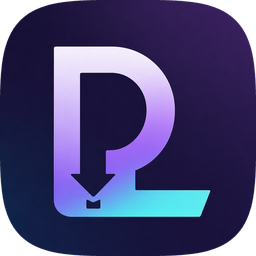

<div align="center">



# MusicPlayer

**A sleek dark-glass desktop GUI for [spotDL](https://github.com/spotDL/spotify-downloader) — paste a Spotify link, pick your tracks, download.**

[](https://www.python.org/)
[](https://github.com/TomSchimansky/CustomTkinter)
[](https://github.com/spotDL/spotify-downloader)
[](#-requirements)
[](#-license)
[](https://github.com/astral-sh/ruff)

[Features](#-features) · [Quick Start](#-quick-start) · [Usage](#-usage) · [Architecture](#-architecture) · [Roadmap](#-roadmap) · [Contributing](#-contributing)

</div>

---

## 📖 About

MusicPlayer puts a friendly face on [spotDL](https://github.com/spotDL/spotify-downloader). Instead of memorizing CLI
flags, you paste a Spotify **track, album, or playlist** URL, review the fetched track list, choose what you want, and
watch the download happen live — all inside a modern, dark, glassmorphism interface.

Heavy work (metadata fetching and downloading) runs in **separate child processes**, so the UI stays buttery smooth
while spotDL does the lifting.

> 💡 **Bring-your-own-links:** Spotify links are used as *metadata input* only. Audio retrieval is handled entirely by
> spotDL and its configured audio providers. See [Legal](#-legal).

## ✨ Features

| | |
| --- | --- |
| 🎧 **All link types** | Tracks, albums, and playlists — one input box for everything. |
| ⚡ **Never-freeze UI** | Metadata fetching runs in an isolated child process. |
| 🔍 **Search & multi-select** | Filter the track list and download only what you pick. |
| 🗂️ **Flexible output** | Choose the destination folder and a custom file-naming template. |
| 🎛️ **Full spotDL control** | Audio format, bitrate, provider, overwrite policy, album art fetching. |
| 📺 **Live progress** | Streaming logs, per-operation progress, and a cancel button that actually cancels. |
| 🔁 **Auto-retry** | Optionally falls back to the YouTube audio provider on failure. |
| 🩺 **Dependency doctor** | Detects missing FFmpeg/Deno and can launch spotDL's installers for you. |
| ⚙️ **Persistent settings** | Your preferences are saved between runs. |
| 🌑 **Dark glassmorphism** | CustomTkinter-based modern interface with a custom app icon. |

## 🚀 Quick Start

### Requirements

- **Python 3.10+**
- **Tkinter** — bundled with Python on Windows/macOS; on Debian/Ubuntu: `sudo apt install python3-tk`
- **FFmpeg & Deno** — required by spotDL (the app checks and can install them for you at first launch)
- [spotDL docs](https://spotdl.readthedocs.io/) cover platform-specific details

### Install & run

```bash
git clone https://github.com/RTiwari-06/SpotDL_UI.git
cd MUSICPLAYER
python -m pip install -r requirements.txt
python main.py
```

<details open>
<summary><strong>🪟 Windows one-click launcher</strong></summary>

```bat
MusicPlayer.bat
```

The launcher prefers a local `.venv` when present, and also supports build/clean modes:

| Command | Action |
| --- | --- |
| `MusicPlayer.bat` | Launch the application |
| `MusicPlayer.bat install` | Install / refresh Python dependencies |
| `MusicPlayer.bat build` | Build the Windows executable with PyInstaller |
| `MusicPlayer.bat clean` | Remove `build/` and `dist/` artifacts |

</details>

## 💻 Usage

1. **Paste** a Spotify track, album, or playlist URL.
2. **Fetch** the track list — runs in the background, UI stays responsive.
3. **Search** and **multi-select** the tracks you want.
4. **Configure** the destination anywhere on disk (defaults to `~/Music/spotDL`) and tweak format, bitrate, provider,
   and more in settings.
5. **Download** and watch the live log — hit cancel any time.

Files are organized by **artist → album** by default, honoring your configured naming template.

### Building the Windows executable

```bat
MusicPlayer.bat build
```

Produces `dist/SpotDL_GUI/SpotDL_GUI.exe` with the application icon applied:

- Only runtime assets (`icon.png`, `icon.ico`) are bundled — `icon_source.png` stays out of the executable.
- The frozen executable resolves assets from the PyInstaller extraction folder and re-launches itself with `--fetch-child`
  for metadata fetching, so the child-process protocol works **without a Python interpreter** on the target machine.

<details>
<summary><strong>🎨 Regenerating icon assets</strong></summary>

Edit `app/assets/icon_source.png` (master artwork), then:

```bash
python tools/build_icons.py
```

This regenerates `icon.png` / `icon.ico` from the master.

</details>

## 🏗 Architecture

```
MUSICPLAYER/
├── app/
│   ├── assets/
│   │   ├── icon.png              # Runtime icon (UI + window)
│   │   ├── icon.ico              # Multi-resolution Windows icon (taskbar / exe)
│   │   └── icon_source.png       # Master artwork — rebuild icons from it
│   ├── core/
│   │   ├── config.py             # Settings manager with JSON persistence
│   │   ├── fetch_tracks_child.py # Standalone spotDL metadata-fetch child process
│   │   ├── platform_utils.py     # Platform helpers (subprocess flags, window icon)
│   │   ├── spotdl_wrapper.py     # Async subprocess engine around spotDL
│   │   └── system_check.py       # Dependency checker (FFmpeg / Deno)
│   └── ui/
│       └── main_window.py        # Glassmorphism CustomTkinter interface
├── tools/
│   └── build_icons.py            # Icon asset generator
├── main.py                       # Entry point (freeze-safe multiprocessing boot)
├── MusicPlayer.bat               # Quick-launch / install / build / clean script
├── pyproject.toml                # Project metadata & tooling
└── requirements.txt              # Python dependencies
```

**Design highlights**

- **Process isolation** — talk to spotDL through async subprocesses; a slow or crashed fetch never takes the UI down.
- **PyInstaller-safe multiprocessing** — `main.py` calls `freeze_support()` before importing UI modules so frozen builds
  never spawn child-process loops on Windows.
- **Pluggable core** — `app/core/` is UI-agnostic; the `music-spotdl` console script entry point is already wired up in
  `pyproject.toml`.

| Dependency | Role |
| --- | --- |
| [spotDL](https://github.com/spotDL/spotify-downloader) | Metadata resolution + audio download engine |
| [CustomTkinter](https://github.com/TomSchimansky/CustomTkinter) | Modern themed Tk UI |
| [Pillow](https://python-pillow.org/) | Icon processing |
| [PyInstaller](https://pyinstaller.org/) (dev) | Windows executable packaging |

## 🗺️ Roadmap

- [ ] Cross-platform one-file builds (macOS / Linux)
- [ ] Download queue with concurrent fetches
- [ ] Progress bars per track (event piping from spotDL)
- [ ] Built-in lyrics output options
- [ ] Auto-update check for spotDL version compatibility

Want to help move any of these? See [Contributing](#-contributing).

## 🤝 Contributing

Contributions are welcome — bug fixes, UI polish, new settings, and docs all count!

1. **Fork** the repository and create your branch:
   ```bash
   git checkout -b feature/your-feature
   ```
2. **Develop & test**
   ```bash
   pip install -r requirements.txt
   pip install pytest ruff      # dev tooling (see pyproject.toml [dev] extra)
   pytest
   ruff check .
   ```
3. **Commit** with a clear, conventional-style message (`feat:`, `fix:`, `docs:`, …)
4. **Open a Pull Request** describing what changed and why.

## ❓ FAQ

<details>
<summary><strong>The app says FFmpeg or Deno is missing — what do I do?</strong></summary>

Use the corresponding install action inside the app's startup check (it launches spotDL's installers), or install them
manually — see the [spotDL docs](https://spotdl.readthedocs.io/).
</details>

<details>
<summary><strong>Why does the window do nothing briefly on some Linux systems?</strong></summary>

Tkinter isn't always bundled. Install it with `sudo apt install python3-tk` (or your distro equivalent).
</details>

<details>
<summary><strong>Where are my downloads?</strong></summary>

By default under `~/Music/spotDL`, organized as artist → album. Change both the folder and the naming template in
settings.
</details>

<details>
<summary><strong>Do I need the CLI spotDL installed?</strong></summary>

No — it's a Python dependency (`requirements.txt`) and is invoked programmatically through `spotdl_wrapper.py`.
</details>

## 📜 Legal

This project uses Spotify links as **metadata input** only; audio retrieval is handled by spotDL using its configured
audio sources. **You** are responsible for ensuring your use complies with applicable laws, Spotify's Terms of Service,
and the rights of artists and copyright holders. This project is **not affiliated with, endorsed by, or sponsored by
Spotify**.

## 📄 License

Released under the [MIT License](https://opensource.org/licenses/MIT). See `pyproject.toml` for license metadata.

## 🙌 Acknowledgements

- [spotDL](https://github.com/spotDL/spotify-downloader) — the powerful engine doing the heavy lifting
- [CustomTkinter](https://github.com/TomSchimansky/CustomTkinter) — gorgeous themed widgets
- [Python](https://www.python.org/) — and everyone who reports bugs and suggests features 💛

## 👥 Contributors

Thanks go to everyone who helps make this project better!

<!-- ALL-CONTRIBUTORS-LIST:START -->
| Contributor | Contributions |
| --- | --- |
| [**RTiwari-06**](https://github.com/RTiwari-06) 📢 | 🚧 project owner · 💡 ideas & review |
| 🤖 **GLM** *(via [OpenCode](https://opencode.ai))* | 💻 code · 🐛 bug fixes · 🔧 PyInstaller build config · 📖 docs & README |
<!-- ALL-CONTRIBUTORS-LIST:END -->

Want to join the list? See [Contributing](#-contributing).

---

<div align="center">

**Found this useful? Give it a ⭐ to help others discover it!**

</div>
